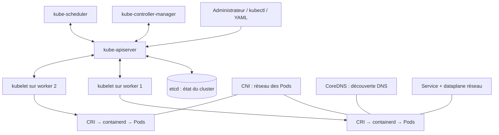
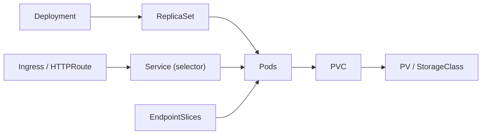
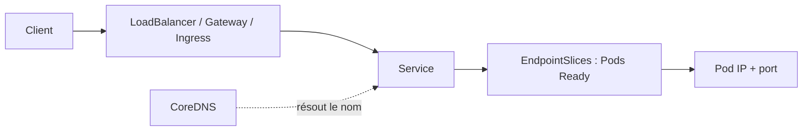
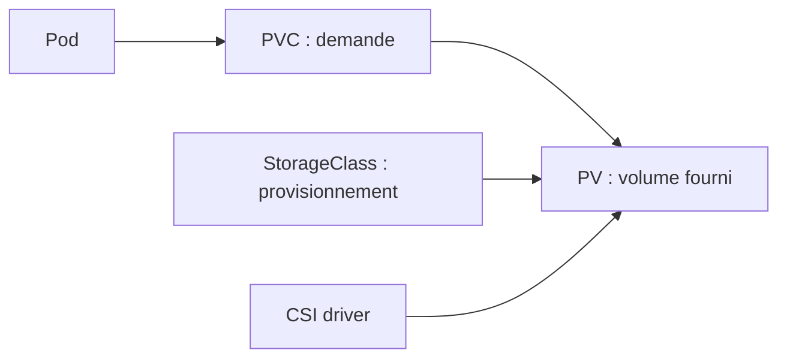

# CKA — Fiche maîtresse de révision

> [!abstract] Le but
> **Comprendre → savoir exécuter → savoir diagnostiquer.** Le CKA est un examen **pratique en terminal**, pas un QCM. Pour chaque notion ci-dessous, tu dois pouvoir expliquer **pourquoi**, écrire **la commande**, puis **vérifier** que le résultat attendu est obtenu.

> [!info] Repères de l'examen
> **Durée : 2 h** · **Seuil de réussite : 66 %** · Plusieurs tâches pratiques dans un environnement Kubernetes. Le programme et la version exacte de Kubernetes doivent toujours être recontrôlés avant ta session sur les pages officielles. **La documentation officielle autorisée** est accessible dans le navigateur de l'environnement d'examen ; **ta note Obsidian personnelle ne l'est pas**.

> [!warning] Ton diagnostic de départ — QCM 20 questions : **14/20**
> Les **6 axes à consolider en priorité** : **RBAC**, **`kubeadm join`**, **NetworkPolicy**, **Gateway API**, **readiness/liveness/startup probes**, **dépannage d'un control plane indisponible**. Ils sont signalés avec **🎯 PRIORITÉ**. Tu as déjà de bonnes bases sur etcd snapshot, upgrade, Kustomize, scheduling, rollback, HPA, Service selectors, DNS, storage et diagnostics des Pods : il faut maintenant savoir *exécuter* ces actions sans QCM.

## 🧭 Carte globale du CKA

| Domaine officiel | Poids | Compétences à maîtriser | Note |
|---|---:|---|---|
| **Troubleshooting** | **30 %** | Pods, Nodes, control plane, réseau, Services, logs, métriques | [[#7. Troubleshooting — le cœur du CKA (30 %)]] |
| **Cluster Architecture, Installation & Configuration** | **25 %** | Architecture, kubeadm, etcd, HA, RBAC, Helm, Kustomize, CNI/CSI/CRI, CRDs/Operators | [[#3. Cluster — architecture, administration, sécurité (25 %)]] |
| **Services & Networking** | **20 %** | Services, EndpointSlice, DNS, NetworkPolicy, Ingress, Gateway API | [[#5. Réseau et Services (20 %)]] |
| **Workloads & Scheduling** | **15 %** | Deployments, DaemonSets, StatefulSets, ConfigMaps, Secrets, probes, HPA, placement | [[#4. Workloads et scheduling (15 %)]] |
| **Storage** | **10 %** | PV/PVC, StorageClass, CSI, access modes, reclaim policy | [[#6. Stockage (10 %)]] |

**Ordre de travail recommandé :** [[#1. Comprendre le système en 10 minutes]] → [[#2. kubectl — les réflexes qui font gagner du temps]] → les 6 priorités → [[#7. Troubleshooting — le cœur du CKA (30 %)]] → [[#8. Exercices pratiques d'entraînement]].

**Suivi personnel** (cocher seulement après réalisation **sans support**) :

- [ ] J'explique le chemin complet de la création d'un Pod.
- [ ] Je crée et débogue des workloads rapidement.
- [ ] Je gère RBAC, kubeadm et les static Pods.
- [ ] Je répare un Service et diagnostique DNS/réseau.
- [ ] Je crée une NetworkPolicy restrictive puis une exception.
- [ ] Je distingue correctement Gateway, HTTPRoute et Ingress.
- [ ] Je crée un PVC et diagnostique un montage bloqué.
- [ ] Je répare un nœud NotReady et un control plane en panne.
- [ ] J'ai terminé une simulation **chronométrée de 2 heures**.

---

# 1. Comprendre le système en 10 minutes

## 1.1 La boucle « état désiré → état réel »

**Kubernetes est un système de réconciliation.** Tu déclares l'état souhaité (`replicas: 3`) ; les contrôleurs observent l'état réel et tentent de le faire converger.



**Exemple :** tu appliques un Deployment à 3 réplicas.

1. **`kubectl`** envoie ta requête au **`kube-apiserver`** (authentification, autorisation, admission, validation).
2. L'état voulu est conservé dans **etcd**.
3. Le **Deployment controller** crée/ajuste un ReplicaSet ; le ReplicaSet crée des Pods.
4. Le **scheduler** trouve un nœud pour chaque Pod qui n'en a pas.
5. Le **kubelet** du nœud demande au runtime (par exemple **containerd**, via **CRI**) de lancer les conteneurs.
6. Le plugin **CNI** permet leur connectivité réseau ; le kubelet publie leur état.
7. Le Service sélectionne les Pods correspondants ; les **EndpointSlices** décrivent les endpoints ; **CoreDNS** permet de retrouver un Service par nom.
8. Si un Pod disparaît, les contrôleurs constatent l'écart et le recréent.

> [!tip] Modèle mental à retenir
> **API = porte d'entrée**, **etcd = mémoire**, **scheduler = placement**, **controllers = réconciliation**, **kubelet = exécution locale**, **CRI = runtime**, **CNI = réseau**, **CSI = stockage**, **CoreDNS = résolution de noms**.

## 1.2 Qui fait quoi ?

| Composant | Responsabilité | Indice lors d'une panne |
|---|---|---|
| `kube-apiserver` | API Kubernetes et contrôles d'accès | `kubectl` ne peut plus contacter le cluster |
| `etcd` | Base clé-valeur de l'état du cluster | API dégradée/indisponible, erreurs de stockage |
| `kube-scheduler` | Attribue les Pods non placés aux Nodes | Nouveaux Pods bloqués `Pending` sans nœud assigné |
| `kube-controller-manager` | Contrôleurs de Deployments, Nodes, etc. | État réel ne converge plus vers l'état demandé |
| `kubelet` | Agent local ; lance/supervise les Pods | Nœud `NotReady`, Pods non démarrés |
| `containerd` / CRI runtime | Exécution des conteneurs | `ContainerCreating`, erreurs runtime |
| CNI | Adressage et réseau des Pods | Pods injoignables, sandbox réseau impossible |
| `kube-proxy` ou alternative eBPF | Implémentation du trafic Service | ClusterIP ne route pas correctement |
| `CoreDNS` | Résolution de noms dans le cluster | `nslookup` échoue, accès par IP parfois OK |
| CSI driver | Provisionnement/montage des volumes | PVC `Pending`, erreurs `FailedMount` |

## 1.3 Les objets et leur relation



- **Pod** : plus petite unité déployée, un ou plusieurs conteneurs partageant réseau et certains volumes.
- **Deployment** : gestion déclarative de replicas et mises à jour d'applications sans identité stable.
- **ReplicaSet** : maintient le nombre de Pods, généralement piloté par Deployment.
- **StatefulSet** : identité stable et stockage par réplica, pour des applications stateful.
- **DaemonSet** : exécute un Pod sur chaque nœud éligible (agents de logs, CNI…).
- **Job / CronJob** : exécution jusqu'à succès / exécution planifiée.
- **Namespace** : frontière logique pour ressources namespacées ; **Node, Namespace, PV, ClusterRole** sont des ressources globales.
- **Labels** identifient ; **selectors** choisissent ; **annotations** transportent des métadonnées non destinées à la sélection.

## 1.4 Anatomie d'un manifeste

```yaml
apiVersion: apps/v1
kind: Deployment
metadata:
  name: web
  namespace: demo
spec:
  replicas: 3
  selector:
    matchLabels:
      app: web
  template:
    metadata:
      labels:
        app: web
    spec:
      containers:
        - name: nginx
          image: nginx:1.27
          ports:
            - containerPort: 80
```

> [!important] Piège classique
> `spec.selector.matchLabels` **doit correspondre** aux labels dans `spec.template.metadata.labels`. L'indentation YAML et la structure `spec.template.spec` sont essentielles.

---

# 2. kubectl — les réflexes qui font gagner du temps

## 2.1 Les commandes à connaître par cœur

```bash
# Contextes : toujours vérifier AVANT de modifier quelque chose
kubectl config get-contexts
kubectl config current-context
kubectl config use-context <context>

# Inventaire
kubectl get nodes -o wide
kubectl get pods -A -o wide
kubectl get deploy,ds,sts,svc -A
kubectl get events -A --sort-by=.metadata.creationTimestamp

# Inspecter
kubectl describe pod <pod> -n <ns>
kubectl get pod <pod> -n <ns> -o yaml
kubectl logs <pod> -n <ns> -c <container>
kubectl logs <pod> -n <ns> -c <container> --previous
kubectl logs -n <ns> deployment/<deploy> --tail=100

# Interagir
kubectl exec -n <ns> -it <pod> -- sh
kubectl apply -f fichier.yaml
kubectl delete -f fichier.yaml
kubectl edit deployment <nom> -n <ns>
kubectl patch deployment <nom> -n <ns> -p '{"spec":{"replicas":3}}'

# Documentation embarquée
kubectl explain deployment.spec.strategy
kubectl explain pod.spec.containers --recursive
kubectl api-resources
kubectl api-versions
```

> [!warning] Espaces réservés
> `<pod>`, `<ns>`, `<context>` et `<nom>` sont à remplacer ; les commandes sont des **patrons**, pas des lignes à coller telles quelles. Vérifie toujours le contexte et le namespace demandés.

## 2.2 Générer du YAML plutôt que tout écrire à la main

```bash
# Pod
kubectl run test --image=nginx:1.27 --restart=Never --dry-run=client -o yaml > pod.yaml

# Deployment
kubectl create deployment web --image=nginx:1.27 --replicas=3 \
  --dry-run=client -o yaml > deployment.yaml

# Service
kubectl expose deployment web --port=80 --target-port=80 \
  --type=ClusterIP --dry-run=client -o yaml > service.yaml

# ConfigMap / Secret
kubectl create configmap app-config --from-literal=MODE=production \
  --dry-run=client -o yaml > configmap.yaml
kubectl create secret generic app-secret --from-literal=PASSWORD='example' \
  --dry-run=client -o yaml > secret.yaml

# Vérification côté API avant application
kubectl apply --dry-run=server -f fichier.yaml
kubectl diff -f fichier.yaml
```

**Pourquoi c'est rapide :** `--dry-run=client -o yaml` crée un squelette ; tu modifies le YAML avec `vim`, puis `kubectl apply -f` et `kubectl get/describe` pour vérifier. Une validation serveur nécessite un API server disponible.

## 2.3 Requêtes utiles

```bash
kubectl get pods -n demo -l app=web -o wide
kubectl get pods -A --field-selector=status.phase=Pending
kubectl get pod web -n demo -o jsonpath='{.spec.nodeName}'
kubectl get pod web -n demo -o jsonpath='{.status.podIP}'
kubectl get nodes --show-labels
kubectl get pods -A --sort-by=.metadata.creationTimestamp
kubectl top nodes      # nécessite Metrics Server
kubectl top pods -A    # nécessite Metrics Server

# Tester les permissions réelles
kubectl auth can-i create deployments -n demo
kubectl auth can-i list pods -n demo --as=system:serviceaccount:demo:reader
```

## 2.4 Trois commandes, trois questions

| Commande | Question à laquelle elle répond |
|---|---|
| `get` | **Qu'est-ce qui existe, dans quel état ?** |
| `describe` | **Pourquoi ?** Conditions, événements, erreurs |
| `logs` | **Que s'est-il passé dans le processus ?** Sortie du conteneur |

Si le conteneur ne démarre pas : commence souvent par `describe`. S'il a déjà démarré : consulte `logs` ; s'il a redémarré : ajoute `--previous`.

---

# 3. Cluster — architecture, administration, sécurité (25 %)

## 3.1 🎯 PRIORITÉ — `kubeadm init`, `join` et cycle de vie

**`kubeadm` prépare et fait évoluer le cluster. `kubectl` interagit avec l'API du cluster.**

| Action | Où ? | Commande clé |
|---|---|---|
| Créer le premier control plane | Premier control plane | `sudo kubeadm init` (avec paramètres adaptés au réseau/CNI) |
| Configurer l'accès admin | Poste/nœud autorisé | `mkdir -p ~/.kube && sudo cp /etc/kubernetes/admin.conf ~/.kube/config && sudo chown "$(id -u):$(id -g)" ~/.kube/config` |
| Générer une commande d'adhésion | Control plane existant | `sudo kubeadm token create --print-join-command` |
| **Joindre un worker** | **Nouveau worker** | `sudo kubeadm join <API_IP>:6443 --token <token> --discovery-token-ca-cert-hash sha256:<hash>` |
| Joindre un control plane supplémentaire | Nouveau control plane | `kubeadm join ... --control-plane ...` (configuration et certificats adaptés) |
| Vérifier | Client configuré | `kubectl get nodes -o wide` |

**À comprendre :** `kubeadm join` permet au nœud d'établir une relation de confiance avec le control plane. **`kubectl create node` ne remplace pas `kubeadm join`**. Le token et le hash de découverte servent au bootstrap sécurisé. Prérequis : runtime de conteneurs, kubelet/kubeadm, réseau et CNI correctement configurés.

**Mettre à niveau un cluster kubeadm :**

1. Sauvegarder les composants critiques et consulter la compatibilité/version skew ; ne pas sauter une version mineure.
2. Sur le **premier control plane**, mettre à jour le paquet `kubeadm`, puis :

```bash
sudo kubeadm upgrade plan
sudo kubeadm upgrade apply v<version-cible>
```

3. Sur les **autres control planes**, utiliser `sudo kubeadm upgrade node` selon la procédure officielle.
4. Sur les workers, exécuter la procédure de drainage/upgrade du kubelet et de kubeadm, dont :

```bash
kubectl drain <worker> --ignore-daemonsets
# sur le worker : mise à jour des paquets, kubeadm upgrade node,
# mise à jour kubelet/kubectl si nécessaire, redémarrage kubelet
kubectl uncordon <worker>
```

> [!warning] Les opérations réelles de mise à niveau
> Exécuter **un nœud à la fois**, suivre la documentation correspondant à la **version installée** ; `drain` peut échouer à cause de Pods non gérés ou de PodDisruptionBudgets. Le flag `--delete-emptydir-data` entraîne la perte des données locales `emptyDir` concernées. Ne l'ajoute pas mécaniquement.

## 3.2 Nœud : cordon, drain, uncordon

```bash
kubectl cordon worker-1                 # n'accepte plus de nouveaux Pods
kubectl drain worker-1 --ignore-daemonsets # évacue ce qui peut l'être
kubectl uncordon worker-1               # autorise à nouveau le scheduling
```

**Cordon ≠ drain :** cordon bloque la planification nouvelle ; drain évacue les Pods concernés via l'API d'éviction ou suppression selon options. Les DaemonSets ne s'évacuent pas comme des Pods ordinaires.

## 3.3 🎯 PRIORITÉ — RBAC : qui a le droit de faire quoi ?

**Formule mentale : `Sujet` + `Binding` → `Role / ClusterRole` → (`verbes`, `ressources`, `portée`).**

| Objet | Portée | Rôle |
|---|---|---|
| `Role` | Namespace | Déclare les permissions dans un namespace |
| `ClusterRole` | Cluster (définition) | Déclare permissions globales **ou** réutilisables en namespace |
| `RoleBinding` | **Namespace** | Accorde un Role ou un ClusterRole **dans ce namespace** |
| `ClusterRoleBinding` | **Cluster** | Accorde un ClusterRole à l'échelle du cluster |
| `ServiceAccount` | Namespace | Identité utilisée par des Pods / workloads |

> [!danger] Le piège de ton QCM
> **`RoleBinding` → `ClusterRole` ne donne PAS accès à tous les namespaces.** La portée dépend du **Binding**. Pour un accès global, il faut un `ClusterRoleBinding` (et seulement si c'est nécessaire).

**Exemple : permettre à une ServiceAccount de lire les Pods dans `backend` :**

```bash
kubectl create namespace backend
kubectl create serviceaccount reader -n backend
kubectl create role pod-reader --verb=get,list,watch --resource=pods -n backend
kubectl create rolebinding read-pods --role=pod-reader \
  --serviceaccount=backend:reader -n backend

kubectl auth can-i list pods -n backend \
  --as=system:serviceaccount:backend:reader
kubectl auth can-i delete pods -n backend \
  --as=system:serviceaccount:backend:reader
```

**Résultat attendu :** lecture autorisée ; suppression interdite, en l'absence d'autres droits. `--as` nécessite que ton identité puisse impersonifier celle ciblée.

**Verbes usuels :** `get`, `list`, `watch`, `create`, `update`, `patch`, `delete`. Ne pas confondre `get` (un objet) et `list` (collection).

**Chemin d'une requête Kubernetes :** authentification → autorisation (RBAC, etc.) → admission → validation/persistance. Les **admission controllers** sont des contrôles/transformations de requêtes API, pas des composants de scheduling.

## 3.4 🎯 PRIORITÉ — static Pods et diagnostic local du control plane

Sur un cluster **kubeadm**, les composants du control plane sont généralement des **static Pods** : leurs manifestes sont sur le nœud et le **kubelet** les surveille.

```text
/etc/kubernetes/manifests/
  kube-apiserver.yaml
  kube-controller-manager.yaml
  kube-scheduler.yaml
  etcd.yaml                  # si etcd local
```

Les **mirror Pods** visibles dans l'API représentent ces static Pods, mais les supprimer via l'API ne les administre pas durablement. **Éditer le manifeste local** déclenche une prise en compte par le kubelet ; **ne pas laisser de fichiers de sauvegarde `.yaml` dans ce dossier**, car le kubelet peut les traiter comme manifestes.

**Si `kubectl` ne marche plus, les commandes à exécuter en SSH sur le control plane :**

```bash
sudo systemctl status kubelet
sudo journalctl -u kubelet -n 100 --no-pager
sudo crictl ps -a
sudo crictl pods
sudo crictl logs <container-id>
sudo ls -l /etc/kubernetes/manifests/
sudo grep -n 'image:\|command:\|--etcd-servers' /etc/kubernetes/manifests/*.yaml
```

**Ordre d'analyse :** kubelet → runtime et conteneurs (`crictl`) → manifestes → certificats → etcd → réseau/API. Ces outils sont locaux et restent pertinents **même quand le kube-apiserver est indisponible**.

## 3.5 etcd : sauvegarder et restaurer

**etcd stocke l'état de l'API Kubernetes**. Sauvegarder des YAML via `kubectl get all` **n'est pas** une sauvegarde de la base etcd.

```bash
# Exemple : les chemins/certificats dépendent du cluster
export ETCDCTL_API=3
sudo etcdctl --endpoints=https://127.0.0.1:2379 \
  --cacert=/etc/kubernetes/pki/etcd/ca.crt \
  --cert=/etc/kubernetes/pki/etcd/healthcheck-client.crt \
  --key=/etc/kubernetes/pki/etcd/healthcheck-client.key \
  snapshot save /tmp/etcd-snapshot.db

# Vérifier un snapshot hors ligne (si etcdutl disponible)
etcdutl snapshot status /tmp/etcd-snapshot.db -w table

# Exemple de restauration dans un nouveau répertoire, PAS sur un cluster actif
sudo etcdutl snapshot restore /tmp/etcd-snapshot.db \
  --data-dir=/var/lib/etcd-restored
```

> [!danger] Restauration = opération sensible
> `etcdutl snapshot restore` prépare un **nouveau répertoire de données**. La restauration complète requiert ensuite une procédure coordonnée pour arrêter/rediriger etcd, vérifier les manifestes, l'appartenance au cluster et la cohérence. Exécute-la **uniquement dans un lab jetable** tant que tu ne maîtrises pas le runbook. `etcdctl snapshot restore` est une ancienne méthode dépréciée : privilégie `etcdutl`.

## 3.6 HA, certificats et interfaces d'extension

- **HA control plane** : plusieurs nœuds control plane + endpoint d'API stable (souvent un load balancer) ; un seul control plane rend l'API vulnérable à la panne de ce nœud.
- **etcd quorum** : besoin d'une majorité de membres sains pour progresser ; 3 membres tolèrent la panne de 1 membre, 5 membres tolèrent 2 pannes.
- **Certificats kubeadm** : `sudo kubeadm certs check-expiration`, `sudo kubeadm certs renew ...` selon procédure autorisée ; une expiration peut rendre l'API inaccessible.
- **CRI** : interface kubelet ↔ runtime de conteneurs (ex. containerd).
- **CNI** : plugin connectivité réseau des Pods.
- **CSI** : interface plugins de stockage et volumes persistants.
- **CRD** : nouveau type de ressource ajouté à l'API ; **Operator** : contrôleur qui agit sur ces ressources pour automatiser un service.

```bash
kubectl get crds
kubectl api-resources | grep -i <mot-cle>
kubectl explain <ressource>
```

## 3.7 Helm et Kustomize — composer et installer

| Outil | Concept | Commandes |
|---|---|---|
| **Helm** | Packages « charts » + `values.yaml` + releases | `helm list -A`, `helm show values`, `helm template`, `helm install`, `helm upgrade`, `helm rollback`, `helm uninstall` |
| **Kustomize** | Superpositions de manifestes YAML (base/overlay) sans templates textuels | `kubectl kustomize ./overlay`, `kubectl apply -k ./overlay` |

```bash
helm list -A
helm repo add stable-demo <url-depot-valide>
helm repo update
helm show values <repo>/<chart>
helm template demo <repo>/<chart> -n demo -f values.yaml
helm install demo <repo>/<chart> -n demo --create-namespace -f values.yaml
helm upgrade demo <repo>/<chart> -n demo -f values.yaml
helm history demo -n demo
helm rollback demo <revision> -n demo
helm uninstall demo -n demo

kubectl kustomize ./overlays/prod
kubectl apply -k ./overlays/prod
```

**Mini structure Kustomize :**

```text
app/
  base/
    deployment.yaml
    service.yaml
    kustomization.yaml
  overlays/
    prod/
      kustomization.yaml
```

```yaml
# overlays/prod/kustomization.yaml
resources:
  - ../../base
namespace: production
replicas:
  - name: web
    count: 4
```

> [!important] Réflexe
> Pour Helm, toujours **examiner** `helm template` avant de déployer si tu modifies les valeurs. Pour Kustomize, examiner `kubectl kustomize` avant `apply -k`.

---

# 4. Workloads et scheduling (15 %)

## 4.1 Choisir le bon contrôleur

| Besoin | Objet |
|---|---|
| Application stateless avec mises à jour/rollback | **Deployment** |
| Un agent par nœud | **DaemonSet** |
| Identité stable / stockage individuel | **StatefulSet** |
| Traitement ponctuel qui termine | **Job** |
| Traitement planifié | **CronJob** |
| Conteneur simple / test court | **Pod** |

## 4.2 Deployment : création, rolling update et rollback

```bash
kubectl create deployment web --image=nginx:1.27 --replicas=3 -n demo
kubectl get deploy,rs,pods -n demo
kubectl set image deployment/web nginx=nginx:1.28 -n demo
kubectl rollout status deployment/web -n demo
kubectl rollout history deployment/web -n demo
kubectl rollout undo deployment/web -n demo
kubectl scale deployment/web --replicas=5 -n demo
kubectl rollout restart deployment/web -n demo
```

`rollout undo` restaure une ancienne révision ; `rollout restart` redémarre la version courante. `RollingUpdate` réalise un remplacement progressif ; `Recreate` supprime l'ancien avant de relancer le nouveau.

## 4.3 Requests / limits et OOMKilled

```yaml
resources:
  requests:
    cpu: "100m"       # 0,1 CPU : base de placement
    memory: "128Mi"
  limits:
    cpu: "500m"       # plafond CPU : throttling possible
    memory: "256Mi"   # dépassement : OOM possible
```

- **Request** : utilisée pour le scheduling et les garanties de ressources.
- **Limit CPU** : limitation de CPU, souvent visible par un ralentissement (`throttling`).
- **Limit mémoire** : un dépassement peut entraîner `OOMKilled`.
- **QoS** : `Guaranteed`, `Burstable`, `BestEffort` influent sur les décisions d'éviction ; dépendent des requests/limits configurées.
- **HPA CPU** basé sur `averageUtilization` : nécessite des **requests CPU** sur les conteneurs concernés et des métriques exploitables.

```bash
kubectl top pods -n demo
kubectl describe hpa -n demo
kubectl autoscale deployment web --cpu-percent=70 --min=2 --max=8 -n demo
```

> [!note] Le HPA ne crée pas la métrique
> Metrics Server est habituellement utilisé pour les métriques CPU/mémoire ; le HPA compare la mesure à la **request**. Un HPA sans métriques disponibles ou sans requests adaptées ne peut pas calculer correctement son ratio d'utilisation CPU.

## 4.4 🎯 PRIORITÉ — Les trois probes, sans confusion

| Probe | Question posée | Si elle échoue |
|---|---|---|
| **readinessProbe** | « Puis-je recevoir du trafic ? » | Pod **non Ready** : retiré des endpoints prêts des Services ; **pas** de redémarrage provoqué par cette probe |
| **livenessProbe** | « Mon processus est-il sain ? » | Le kubelet **redémarre le conteneur** après échecs selon configuration/politique |
| **startupProbe** | « L'application a-t-elle fini de démarrer ? » | Liveness/readiness attendent la réussite de startup ; si échec au seuil, le conteneur est redémarré |

```yaml
# Fragment à placer sous spec.containers[0]
ports:
  - containerPort: 8080
startupProbe:
  httpGet:
    path: /healthz
    port: 8080
  periodSeconds: 5
  failureThreshold: 30
readinessProbe:
  httpGet:
    path: /ready
    port: 8080
  periodSeconds: 5
  failureThreshold: 3
livenessProbe:
  httpGet:
    path: /healthz
    port: 8080
  periodSeconds: 10
  failureThreshold: 3
```

**Cas classique :** une app répond à `/healthz` mais est temporairement incapable de recevoir du trafic → readiness échoue, elle ne doit pas être tuée. **Piège de ton QCM : readiness ≠ liveness.**

## 4.5 ConfigMaps / Secrets

**ConfigMap** : configuration non sensible. **Secret** : donnée sensible au sens fonctionnel, mais **base64 n'est PAS du chiffrement** ; activer les contrôles d'accès et, en production, envisager chiffrement au repos.

```bash
kubectl create configmap app-config --from-literal=LOG_LEVEL=debug -n demo
kubectl create secret generic db-secret --from-literal=DB_PASSWORD='example' -n demo
kubectl get cm,secret -n demo
```

```yaml
# Fragment dans un conteneur
containers:
  - name: app
    image: nginx:1.27
    env:
      - name: LOG_LEVEL
        valueFrom:
          configMapKeyRef:
            name: app-config
            key: LOG_LEVEL
      - name: DB_PASSWORD
        valueFrom:
          secretKeyRef:
            name: db-secret
            key: DB_PASSWORD
```

**À savoir :** ConfigMaps/Secrets peuvent être injectés via variables d'environnement ou volumes. Un changement n'actualise pas automatiquement la variable d'environnement dans un processus déjà lancé.

## 4.6 Placement : labels, taints, affinity, PDB

**Questions essentielles :** « Sur quel Node ? », « Avec quels autres Pods ? », « Quelles interruptions autoriser ? »

| Mécanisme | Sens |
|---|---|
| `nodeSelector` | Exige un label de nœud précis |
| `nodeAffinity` | Critères de placement plus expressifs (required / preferred) |
| `podAffinity` / `podAntiAffinity` | Rapprocher / séparer les Pods |
| `topologySpreadConstraints` | Répartir les Pods entre zones/nœuds |
| `taint` sur Node | Repousse des Pods |
| `toleration` sur Pod | Permet de **tolérer** le taint, sans garantir le placement |
| `PodDisruptionBudget` | Limite certaines interruptions volontaires lors des évictions |

```bash
kubectl label node worker-1 disk=ssd
kubectl taint nodes worker-1 dedicated=infra:NoSchedule
kubectl describe node worker-1 | grep -A3 Taints
kubectl taint nodes worker-1 dedicated=infra:NoSchedule-  # retrait
```

```yaml
# Fragment : spec du Pod
tolerations:
  - key: dedicated
    operator: Equal
    value: infra
    effect: NoSchedule
nodeSelector:
  disk: ssd
```

**Différences des taints :**
- `NoSchedule` : empêche de nouveaux placements sans tolérance ; ne chasse pas les Pods existants.
- `PreferNoSchedule` : préférence, pas interdiction absolue.
- `NoExecute` : empêche placement et peut évincer des Pods existants non tolérants (selon les règles et durées).

> [!tip] Dépanner un Pending
> Contrôler `kubectl describe pod` : `Insufficient cpu`, `node(s) had untolerated taint`, `didn't match node selector`, `unbound immediate PersistentVolumeClaims`, contraintes de topologie, etc.

---

# 5. Réseau et Services (20 %)

## 5.1 Comprendre le chemin d'une requête



- Chaque Pod a normalement une **IP propre** ; un Service offre une **identité stable**.
- `ClusterIP` : adresse virtuelle interne. `NodePort` : port exposé sur les nœuds. `LoadBalancer` : intégration avec un équilibre de charge externe lorsque l'environnement le supporte. `ExternalName` : alias DNS ; **headless Service** (`clusterIP: None`) expose les endpoints DNS différemment.
- `port` = port du **Service** ; `targetPort` = port du **conteneur/backend** ; `nodePort` = port sur chaque nœud pour un Service NodePort.
- **EndpointSlice** associe Service et endpoints sélectionnés, en particulier les Pods prêts pour le trafic ordinaire.

```yaml
apiVersion: v1
kind: Service
metadata:
  name: web
  namespace: demo
spec:
  selector:
    app: web
  ports:
    - port: 80
      targetPort: 8080
  type: ClusterIP
```

**Ne pas confondre :** un conteneur avec `containerPort: 8080` ne reçoit pas automatiquement du trafic si le Service ne sélectionne pas les bons labels.

## 5.2 Déboguer un Service : 5 étapes

```bash
kubectl get svc web -n demo -o wide
kubectl describe svc web -n demo
kubectl get pods -n demo --show-labels -o wide
kubectl get endpointslices -n demo -l kubernetes.io/service-name=web -o wide
kubectl get pods -n demo -l app=web
```

1. **Service présent ?** Vérifier nom, namespace, type, `port/targetPort`.
2. **Selector correct ?** `spec.selector` doit coïncider avec les labels du Pod.
3. **Endpoints présents et prêts ?** Sinon inspecter Pods et readiness probes.
4. **DNS OK ?** Tester nom du Service depuis un autre Pod.
5. **Réseau/policy OK ?** Tester l'IP directement et vérifier les politiques.

## 5.3 DNS et CoreDNS

Nom DNS complet d'un Service : **`<service>.<namespace>.svc.cluster.local`** (si domaine du cluster = `cluster.local`).

```bash
kubectl get pods -n kube-system -l k8s-app=kube-dns
kubectl get svc -n kube-system kube-dns
kubectl get configmap -n kube-system coredns -o yaml

# Pod de test temporaire (si registre accessible)
kubectl run dns-test -n demo --rm -it --restart=Never \
  --image=busybox:1.36 -- nslookup web.demo.svc.cluster.local
```

Si DNS échoue : vérifier CoreDNS, le Service `kube-dns`, les règles egress DNS et la connexion réseau. **Une NetworkPolicy egress default-deny peut bloquer le DNS**.

## 5.4 🎯 PRIORITÉ — NetworkPolicy

**Modèle mental :** une NetworkPolicy **sélectionne des Pods** (`podSelector`) et permet seulement certains flux **dans les directions isolées** (`Ingress`, `Egress`). Les permissions entre politiques sont **additives** : une politique ne révoque pas un trafic déjà autorisé par une autre.

> [!warning] Important
> Une NetworkPolicy **n'est effective que si le plugin réseau (CNI) l'applique**. Certains CNIs ne prennent pas en charge les NetworkPolicies standard.

### A. Interdire tout le trafic ENTRANT vers les Pods d'un namespace

```yaml
apiVersion: networking.k8s.io/v1
kind: NetworkPolicy
metadata:
  name: default-deny-ingress
  namespace: demo
spec:
  podSelector: {}   # tous les Pods de demo
  policyTypes:
    - Ingress       # aucune règle ingress = aucune nouvelle entrée autorisée
```

**Effet :** isoler **le trafic entrant** vers ces Pods ; **l'egress n'est pas isolé par cette policy**. Ce n'est **pas seulement le trafic extérieur au cluster**. Le comportement a quelques exceptions liées au nœud et à certaines implémentations ; retenir la règle Kubernetes pour les flux Pod-à-Pod.

### B. Tout interdire dans les deux sens

```yaml
apiVersion: networking.k8s.io/v1
kind: NetworkPolicy
metadata:
  name: default-deny-all
  namespace: demo
spec:
  podSelector: {}
  policyTypes: [Ingress, Egress]
```

### C. Autoriser seulement `frontend` → `backend` sur TCP 8080, dans le même namespace

```yaml
apiVersion: networking.k8s.io/v1
kind: NetworkPolicy
metadata:
  name: allow-frontend
  namespace: demo
spec:
  podSelector:
    matchLabels:
      app: backend
  policyTypes:
    - Ingress
  ingress:
    - from:
        - podSelector:
            matchLabels:
              app: frontend
      ports:
        - protocol: TCP
          port: 8080
```

**Attention :** sans autre NetworkPolicy, les Pods non sélectionnés restent non isolés. Pour filtrer aussi l'egress des frontends, il faut considérer une politique egress ; un flux Pod→Pod doit être autorisé par la politique egress de la source **et** la politique ingress de la destination lorsqu'elles s'appliquent.

### D. `namespaceSelector` et `podSelector` : ET ou OU ?

```yaml
# ET : une seule entrée from comporte les deux sélecteurs
from:
  - namespaceSelector:
      matchLabels:
        team: blue
    podSelector:
      matchLabels:
        app: frontend
```

```yaml
# OU : deux entrées from distinctes
from:
  - namespaceSelector:
      matchLabels:
        team: blue
  - podSelector:
      matchLabels:
        app: frontend
```

**À savoir :** `podSelector` seul référence des Pods du namespace de la policy ; `namespaceSelector` peut élargir à d'autres namespaces ; `ipBlock` cible des plages CIDR.

### E. À ne pas oublier : DNS sortant

Si `Egress` est isolé, prévoir une autorisation explicite vers le DNS (souvent UDP et TCP port 53) selon les labels/namespace de CoreDNS et le CNI utilisé.

```bash
kubectl get networkpolicy -A
kubectl describe networkpolicy -n demo
kubectl get pods -n kube-system --show-labels
```

## 5.5 Ingress versus Gateway API

| Objet | À quoi ça sert ? | Dépendance |
|---|---|---|
| **Ingress** | Routage HTTP(S) host/path vers un Service | Contrôleur Ingress installé |
| **IngressClass** | Identifie la classe de contrôleur Ingress | Contrôleur correspondant |
| **GatewayClass** | Classe d'implémentation Gateway | Contrôleur Gateway compatible |
| **Gateway** | Infrastructure d'entrée / listeners (ports, protocoles, hosts) | GatewayClass |
| **HTTPRoute** | **Règles HTTP : host/path → Service** | Gateway attachée et controller/CRDs actifs |

> [!danger] 🎯 PRIORITÉ : le piège de ton QCM
> **NetworkPolicy n'effectue PAS de routage HTTP par host/path.** C'est **HTTPRoute** (Gateway API) ou **Ingress** (modèle traditionnel). NetworkPolicy détermine quels flux réseaux sont autorisés entre Pods.

**Ingress classique :**

```yaml
apiVersion: networking.k8s.io/v1
kind: Ingress
metadata:
  name: web
  namespace: demo
spec:
  ingressClassName: nginx  # seulement si cette classe existe
  rules:
    - host: web.example.test
      http:
        paths:
          - path: /
            pathType: Prefix
            backend:
              service:
                name: web
                port:
                  number: 80
```

**HTTPRoute minimale** (suppose un Gateway nommé `shared-gateway` **déjà existant**, autorisant cet attachement, et un contrôleur compatible) :

```yaml
apiVersion: gateway.networking.k8s.io/v1
kind: HTTPRoute
metadata:
  name: web-route
  namespace: demo
spec:
  parentRefs:
    - name: shared-gateway
  hostnames:
    - web.example.test
  rules:
    - matches:
        - path:
            type: PathPrefix
            value: /
      backendRefs:
        - name: web
          port: 80
```

> [!note] Important pour cet exemple
> `parentRefs` sans `namespace` suppose un Gateway **dans le même namespace** `demo`. Si le Gateway est ailleurs, préciser `namespace` et vérifier `allowedRoutes` + permissions de références inter-namespace (selon les objets concernés).

```bash
kubectl get gatewayclasses
kubectl get gateways -A
kubectl get httproutes -A
kubectl describe httproute web-route -n demo
kubectl get ingressclasses
kubectl get ingress -A
```

---

# 6. Stockage (10 %)

## 6.1 La chaîne PV / PVC / StorageClass



- **PV** : volume de stockage disponible au cluster, avec durée de vie indépendante du Pod.
- **PVC** : demande de stockage dans un namespace (taille, access mode, class…).
- **StorageClass** : décrit le provisionnement dynamique et d'autres propriétés (driver, reclaim policy, binding mode).
- **CSI** : intégration au fournisseur de stockage.

**États typiques :** PVC/PV `Pending` (en attente), `Bound` (lié), PV `Released` (claim supprimé mais ressource non récupérée automatiquement, selon policy).

## 6.2 Access modes — question classique

| Mode | Signification simplifiée |
|---|---|
| `ReadWriteOnce` (RWO) | Lecture-écriture par **un nœud** à la fois ; potentiellement plusieurs Pods sur ce nœud |
| `ReadOnlyMany` (ROX) | Lecture seule par plusieurs nœuds |
| `ReadWriteMany` (RWX) | Lecture-écriture par plusieurs nœuds |
| `ReadWriteOncePod` (RWOP) | Lecture-écriture par **un seul Pod**, avec pilotes/support compatibles |

**Reclaim policy :** `Delete` demande suppression du volume sous-jacent via l'implémentation ; `Retain` conserve les données et demande récupération manuelle. **Attention :** supprimer un PVC ne signifie pas forcément supprimer le stockage physique.

## 6.3 PVC et montage dans un Pod

```yaml
apiVersion: v1
kind: PersistentVolumeClaim
metadata:
  name: data
  namespace: demo
spec:
  accessModes:
    - ReadWriteOnce
  resources:
    requests:
      storage: 1Gi
  storageClassName: standard  # doit exister dans ton cluster
---
apiVersion: v1
kind: Pod
metadata:
  name: storage-test
  namespace: demo
spec:
  containers:
    - name: test
      image: busybox:1.36
      command: ["sh", "-c", "sleep 3600"]
      volumeMounts:
        - name: data
          mountPath: /data
  volumes:
    - name: data
      persistentVolumeClaim:
        claimName: data
```

```bash
kubectl get storageclass
kubectl get pvc,pv -A
kubectl describe pvc data -n demo
kubectl describe pod storage-test -n demo
kubectl get events -n demo --sort-by=.metadata.creationTimestamp
```

**Débogage :** classe inexistante, provisioner/CSI indisponible, capacité insuffisante, access mode incompatible, volume non disponible, contrainte de topologie, `WaitForFirstConsumer` (le binding attend le Pod consommateur).

---

# 7. Troubleshooting — le cœur du CKA (30 %)

> [!important] Méthode universelle : **C-L-E-A-R**
> **C**ontexte/namespace → **L**ister l'état → **E**vents + `describe` → **A**nalyser logs/config/réseau → **R**éparer et **revérifier**. Le but n'est pas de deviner une commande : il faut réduire progressivement le nombre de causes possibles.

```bash
# 1. Bon cluster ?
kubectl config current-context
# 2. Où est l'incident ?
kubectl get nodes -o wide
kubectl get pods -A -o wide
# 3. Pourquoi ?
kubectl describe pod <pod> -n <ns>
kubectl get events -n <ns> --sort-by=.metadata.creationTimestamp
# 4. Logs ?
kubectl logs <pod> -n <ns> --previous
# 5. Confirmer la réparation
kubectl get pod <pod> -n <ns> -o wide
```

## 7.1 Matrice diagnostic rapide

| Symptôme | Causes fréquentes | Première vérification |
|---|---|---|
| `Pending` | CPU/RAM insuffisants, taints, affinités, PVC non Bound | `kubectl describe pod` → **Events** |
| `ImagePullBackOff` | Image/tag erroné, registre indisponible, credentials | `kubectl describe pod` |
| `CrashLoopBackOff` | Erreur application, arguments, configuration, probes | `kubectl logs --previous` + `describe` |
| `CreateContainerConfigError` | ConfigMap/Secret/key manquante | `kubectl describe pod` |
| `OOMKilled` | Mémoire dépassée | `kubectl describe pod` + requests/limits |
| Pod `Running` mais pas `Ready` | readinessProbe échouée, dépendance indisponible | `describe pod`, état probes, logs |
| `ContainerCreating` bloqué | CNI, image, volume, sandbox | `describe pod`, kubelet, CSI/CNI |
| `Node NotReady` | kubelet, CRI, réseau, pression disque/mémoire | `describe node`, `systemctl status kubelet` |
| Service sans endpoints | Selector erroné ou Pods non Ready | `get pods --show-labels`, `get endpointslices` |
| DNS échoue | CoreDNS, egress port 53, CNI | `nslookup` depuis Pod, CoreDNS |
| PVC `Pending` | StorageClass/CSI/capacité/topologie | `kubectl describe pvc` |
| `kubectl` indisponible | API, certificats, etcd, réseau, kubelet local | SSH control plane + `crictl` / journalctl |
| HPA `unknown` | Metrics Server/requests manquantes | `describe hpa`, `top`, manifest |

## 7.2 Runbook : Pod `Pending`

```bash
kubectl describe pod <pod> -n <ns>
kubectl get nodes -o wide
kubectl describe node <node>
kubectl get pvc -n <ns>
kubectl get events -n <ns> --sort-by=.metadata.creationTimestamp
```

**Décision :**
- `Insufficient cpu` / `memory` → examiner requests et capacité ; corriger dimensionnement.
- `untolerated taint` → tolérance appropriée **ou** retirer le taint si légitime.
- `node(s) didn't match...` → labels/affinity incorrects.
- `unbound PersistentVolumeClaims` → storage (SC/PV/CSI).

## 7.3 Runbook : `CrashLoopBackOff`

```bash
kubectl logs <pod> -n <ns> --previous
kubectl describe pod <pod> -n <ns>
kubectl get pod <pod> -n <ns> -o jsonpath='{.status.containerStatuses[*].lastState}'
```

**Chercher :** mauvais `command/args`, fichier de config absent, Secret absent, port incorrect, crash applicatif, mémoire, probe liveness trop agressive. **Ne pas** supprimer les Pods en boucle sans identifier la cause.

## 7.4 Runbook : Node `NotReady`

```bash
kubectl describe node <node>
# Puis SSH sur le node
sudo systemctl status kubelet
sudo journalctl -u kubelet -n 100 --no-pager
sudo systemctl status containerd   # si containerd utilisé
sudo crictl ps -a
sudo df -h
```

**Chercher :** kubelet arrêté, runtime indisponible, problèmes de CNI, filesystem plein, certificats/connexion API, conditions `MemoryPressure` / `DiskPressure` / `PIDPressure`.

## 7.5 🎯 PRIORITÉ — Runbook : kube-apiserver/control plane indisponible

**Situation :** `kubectl get nodes` retourne une erreur de connexion. Tu dois passer **en SSH** sur le control plane. L'API ne peut plus servir de source unique de diagnostic.

```bash
# 1. Vérifier que le kubelet fonctionne
sudo systemctl status kubelet
sudo journalctl -u kubelet -n 100 --no-pager

# 2. Vérifier les static Pods via le runtime (sans API)
sudo crictl ps -a
sudo crictl pods
sudo crictl logs <id-de-conteneur>

# 3. Contrôler les fichiers locaux
sudo ls -la /etc/kubernetes/manifests
sudo grep -n 'image:\|--advertise-address\|--etcd-servers' \
  /etc/kubernetes/manifests/kube-apiserver.yaml

# 4. Vérifier les certificats administrés par kubeadm
sudo kubeadm certs check-expiration

# 5. Vérifier etcd selon le déploiement
sudo crictl ps -a | grep etcd
```

**Ne pas confondre :** `kubectl rollout restart deployment/kube-apiserver` **n'est pas le correctif** pour un kube-apiserver en static Pod. La présence de `kubectl` ne garantit pas que l'API répond.

**Causes typiques :** YAML cassé après édition, certificat expiré, image non disponible, kubelet arrêté, etcd hors service, mauvais endpoint ou connectivité. **Corriger la cause identifiée**, attendre la reprise puis valider depuis l'API.

## 7.6 Runbook : Service non accessible

```bash
kubectl get svc web -n demo -o yaml
kubectl get pods -n demo --show-labels
kubectl get endpointslices -n demo -l kubernetes.io/service-name=web
kubectl describe pod <backend> -n demo
kubectl get networkpolicy -n demo

# Test DNS + connectivité depuis un Pod de diagnostic
kubectl run diag -n demo --rm -it --restart=Never \
  --image=busybox:1.36 -- sh
# À l'intérieur :
# nslookup web.demo.svc.cluster.local
# wget -S -O- http://web.demo.svc.cluster.local:80/
```

**Arbre de décision :**
1. Pas de Service → objet absent / mauvais namespace.
2. Service mais pas d'endpoints → selector ou readiness.
3. Endpoints OK, DNS KO → CoreDNS / DNS egress.
4. DNS OK, connexion KO → port/targetPort, app, politiques, dataplane Service/CNI.
5. Test par Pod IP OK mais par ClusterIP KO → examiner routage Service (kube-proxy ou alternative).

## 7.7 Runbook : réseau / NetworkPolicy

**Toujours séparer :**
- Direction **ingress** vers destination.
- Direction **egress** depuis source.
- Labels `podSelector`/`namespaceSelector`.
- Port du **Pod de destination** (et protocole), pas automatiquement port du Service.
- Disponibilité du CNI et soutien des policies.

Une policy est **additive**, pas un pare-feu « deny » prioritaire ; une policy de type default-deny isole une direction, puis des exceptions peuvent autoriser certains flux.

## 7.8 Runbook : métriques, logs, performances

```bash
kubectl top nodes
kubectl top pods -A
kubectl get hpa -A
kubectl describe hpa <nom> -n <ns>
kubectl logs deployment/<nom> -n <ns> --tail=100
kubectl logs <pod> -n <ns> --previous
kubectl get events -A --sort-by=.metadata.creationTimestamp
```

`top` nécessite une API de métriques fonctionnelle. Si elle est absente, utiliser les événements, statuts et autres outils disponibles ; ne pas supposer que `top` fonctionnera.

---

# 8. Exercices pratiques d'entraînement

> [!success] Barème d'entraînement personnel
> Un exercice est **validé seulement si tu sais le réaliser et en vérifier l'effet sans consulter cette fiche**. Si tu dois lire la solution : note le thème pour une répétition espacée. Pour les opérations destructives (etcd, upgrade, drain), utilise exclusivement un **cluster de laboratoire jetable**.

## Niveau A — Les réflexes (viser 5 à 8 minutes chacun)

- [ ] **L01 — Contextes :** liste les contextes, change de contexte, vérifie le namespace et reviens au contexte initial. **Prouver :** `kubectl config current-context`.
- [ ] **L02 — Manifestes :** crée un namespace `demo`, puis un Deployment `web` de 3 replicas avec une image nginx. **Prouver :** Pods `Running` et labels corrects.
- [ ] **L03 — Service :** expose `web` en ClusterIP sur 80, puis diagnostique volontairement un selector incorrect. **Prouver :** EndpointSlices redevenus peuplés.
- [ ] **L04 — Rolling update :** change l'image de `web`, observe le rollout, reviens à la révision précédente. **Prouver :** image réellement restaurée.
- [ ] **L05 — ConfigMap/Secret :** injecte un paramètre ConfigMap et un Secret comme variables d'environnement. **Prouver :** `exec` dans le Pod de lab (ne pas afficher de secrets réels).
- [ ] **L06 — Probes :** configure les trois probes d'une application de test ; provoque un échec readiness. **Prouver :** le Pod devient non Ready sans redémarrage causé par readiness.

## Niveau B — Sujets clés (viser 8 à 12 minutes chacun)

- [ ] **L07 — RBAC 🎯 :** crée une SA `reader` autorisée à `get/list/watch pods` dans `demo`, pas à `delete pods`. **Prouver :** deux `kubectl auth can-i --as=...` opposés.
- [ ] **L08 — Join 🎯 :** sur un lab kubeadm, récupère la commande join sur le control plane et ajoute un worker. **Prouver :** nœud `Ready`.
- [ ] **L09 — Scheduling :** taint un nœud `dedicated=infra:NoSchedule`, teste un Pod sans et avec toleration. **Prouver :** événements de scheduling cohérents.
- [ ] **L10 — HPA :** configure requests CPU + HPA d'un Deployment. **Prouver :** `kubectl describe hpa` affiche des métriques exploitables (si Metrics Server présent).
- [ ] **L11 — Storage :** crée un PVC de 1Gi puis un Pod qui le monte. **Prouver :** PVC `Bound` et fichier persistant après recréation du Pod, si le provisioner le permet.
- [ ] **L12 — NetworkPolicy 🎯 :** applique default-deny ingress dans `demo` puis autorise uniquement `frontend` vers `backend` sur un port défini. **Prouver :** tests positif et négatif, avec CNI compatible.
- [ ] **L13 — DNS :** résous `web.demo.svc.cluster.local` depuis un Pod puis simule une panne DNS/egress. **Prouver :** diagnostic jusqu'à la cause.
- [ ] **L14 — HTTPRoute 🎯 :** sur un lab avec Gateway API installée, rattache une HTTPRoute à une Gateway existante et route `web.example.test` vers `web`. **Prouver :** route Accepted/ResolvedRefs et test HTTP avec Host adapté.

## Niveau C — Incidents réalistes (viser 10 à 15 minutes chacun)

- [ ] **L15 — `CrashLoopBackOff` :** casse volontairement la commande d'une application ; retrouve la cause avec `logs --previous`, corrige et valide.
- [ ] **L16 — `ImagePullBackOff` :** utilise une image avec un tag inexistant ; distingue erreur registre/image de crash applicatif.
- [ ] **L17 — `Pending` :** crée une demande de ressources incompatible ou un nodeSelector impossible ; retrouve précisément la contrainte dans Events.
- [ ] **L18 — Control plane 🎯 :** dans un cluster kubeadm jetable, rends un manifeste static Pod invalide puis diagnostique **sans `kubectl`**, avec `journalctl` et `crictl` ; rétablis le manifeste.
- [ ] **L19 — etcd :** sauvegarde etcd, vérifie le snapshot et explique une restauration hors ligne **sans écraser les données d'origine**.
- [ ] **L20 — Helm/Kustomize :** installe un chart test via Helm, change une valeur, fais un rollback ; puis applique un overlay Kustomize et vérifie ses différences.

## Scénarios de compréhension (répondre sans terminal)

1. **Un Pod est `Running` mais absent des endpoints du Service.** Quelles sont les trois premières vérifications ?
2. **L'API est inaccessible, mais certains Pods continuent de fonctionner.** Pourquoi est-ce possible ?
3. **Une policy `Ingress` sans règles existe.** Quel trafic est isolé ? Qu'en est-il de l'egress ?
4. **Un RoleBinding référence un ClusterRole.** Quelle est la portée effective ?
5. **Un HPA affiche `unknown`.** Quel lien existe entre requests et utilisation CPU ?
6. **Une HTTPRoute existe, mais le trafic n'arrive pas au Service.** Quelles relations et conditions dois-tu vérifier ?
7. **`ReadWriteOnce` autorise-t-il deux Pods sur le même nœud ?** Pourquoi ?
8. **Un conteneur redémarre quand `/live` ne répond plus, mais pas quand `/ready` échoue.** Explique précisément la différence.

---

# 9. Les confusions qui coûtent des points

| Faux réflexe | Correctif mental |
|---|---|
| « `RoleBinding` vers `ClusterRole` donne accès partout » | **Non** : RoleBinding = portée namespace |
| « Un worker rejoint avec `kubectl create node` » | **Non** : **`kubeadm join`** sur le worker |
| « Readiness redémarre le conteneur » | **Non** : c'est une vérification d'aptitude à recevoir du trafic |
| « NetworkPolicy route HTTP par chemin » | **Non** : **HTTPRoute** ou Ingress |
| « NetworkPolicy `Ingress` bloque aussi l'egress » | **Non** : directions indépendantes |
| « Modifier un Deployment redémarre le kube-apiserver kubeadm » | **Non** : static Pod géré localement par kubelet |
| « RWO = un Pod unique » | **Non** : RWO = restriction par **nœud** ; RWOP = par Pod |
| « `port` et `targetPort` sont synonymes » | **Non** : port du Service versus destination du backend |
| « Un Service existant garantit des endpoints » | **Non** : selector + Pods Ready à vérifier |
| « `kubectl get all` sauvegarde etcd » | **Non** : snapshot etcd requis |
| « `rollout restart` fait un rollback » | **Non** : restart = même configuration ; undo = révision antérieure |
| « Un Secret base64 est cryptographiquement chiffré » | **Non** : encodage ≠ chiffrement |

---

# 10. Antisèche terminal — 60 secondes de lecture

```bash
# Contrôler le contexte
kubectl config get-contexts
kubectl config current-context
kubectl config use-context <ctx>

# Décrire / diagnostiquer
kubectl get pods -A -o wide
kubectl get nodes -o wide
kubectl get events -A --sort-by=.metadata.creationTimestamp
kubectl describe pod <pod> -n <ns>
kubectl logs <pod> -n <ns> --previous
kubectl top nodes
kubectl top pods -A
kubectl explain pod.spec --recursive

# Créer / modifier
kubectl create deployment web --image=nginx:1.27 --replicas=3
kubectl expose deployment web --port=80 --target-port=80
kubectl apply -f objet.yaml
kubectl apply -k ./overlays/prod
kubectl edit deployment web
kubectl set image deployment/web nginx=nginx:1.28
kubectl scale deployment/web --replicas=3

# Déploiement
kubectl rollout status deployment/web
kubectl rollout history deployment/web
kubectl rollout undo deployment/web
kubectl rollout restart deployment/web

# Cluster / nœuds
kubectl cordon <node>
kubectl drain <node> --ignore-daemonsets
kubectl uncordon <node>
sudo kubeadm token create --print-join-command
sudo kubeadm upgrade plan
sudo kubeadm upgrade apply v<version>
sudo kubeadm upgrade node

# RBAC
kubectl auth can-i get pods -n <ns>
kubectl auth can-i delete pods -n <ns> --as=system:serviceaccount:<ns>:<sa>

# Réseau / stockage
kubectl get svc,endpointslices -A
kubectl get networkpolicy -A
kubectl get gatewayclasses,gateways,httproutes -A
kubectl get ingress -A
kubectl get pvc -A
kubectl get pv,sc

# Control plane local (quand l'API ne répond plus)
sudo systemctl status kubelet
sudo journalctl -u kubelet -n 100 --no-pager
sudo crictl ps -a
sudo crictl logs <container-id>
sudo ls /etc/kubernetes/manifests/

# Outils de packaging
helm list -A
helm template <release> <chart>
helm upgrade <release> <chart>
helm rollback <release> <revision>
kubectl kustomize <dossier>
```

---

# 11. Stratégie d'examen et révision active

## 11.1 Stratégie en 2 heures

1. **Lire le contexte imposé** dans chaque tâche : parfois les clusters/contexts diffèrent. Toujours vérifier le namespace.
2. **Parcourir les tâches et sécuriser d'abord les points accessibles**. N'insiste pas trop longtemps sur une tâche bloquante.
3. **Créer rapidement**, mais toujours **vérifier**. L'objectif est l'état final correct, pas seulement une commande exécutée.
4. Quand tu modifies un composant central, utiliser un plan de restauration clair. Sauvegarder un manifeste avant une modification sensible, **hors du dossier de static Pods**.
5. Gérer les `drain`, snapshots etcd et upgrades avec prudence : suivre les consignes précises de la tâche.
6. Prévoir un dernier passage sur toutes les ressources créées/modifiées, dans le **bon contexte** et le **bon namespace**.

## 11.2 Méthode d'apprentissage rapide : comprendre → répéter → dépanner

| Passage | Exercice mental | Résultat recherché |
|---|---|---|
| **1. Comprendre** | Explique à voix haute le chemin API → etcd → scheduler → kubelet | Tu comprends le *pourquoi* |
| **2. Reproduire** | Exécute les commandes sans copier-coller | Tu maîtrises le *comment* |
| **3. Casser/réparer** | Déclenche un incident dans un cluster jetable | Tu sais diagnostiquer |
| **4. Rappel actif** | Cache la fiche, écris la commande de mémoire | Tu récupères l'info rapidement |
| **5. Revoir** | À J+1 puis J+3 les commandes oubliées | Tu consolides les points fragiles |

### Plan intensif de 4 jours

| Jour | Priorité | Travail pratique |
|---|---|---|
| **J1** | Architecture, RBAC, kubeadm, static Pods, etcd | L07, L08, L18, L19 |
| **J2** | Réseau, NetworkPolicy, DNS, Gateway API | L03, L12, L13, L14 |
| **J3** | Workloads, probes, storage, Helm/Kustomize | L02, L04, L06, L10, L11, L20 |
| **J4** | Troubleshooting et simulation 2 h | L15, L16, L17 + simulation chronométrée |

> [!success] Critères de préparation
> - [ ] Les **6 faiblesses** du QCM sont devenues des procédures maîtrisées.
> - [ ] Je peux diagnostiquer un incident Pod/Service/Node en **moins de 5 minutes** dans un lab simple.
> - [ ] Je sais travailler **sans aide externe** sur 15 à 20 tâches réalistes.
> - [ ] J'ai fait **au moins une simulation de 2 h** et analysé mes erreurs.
> - [ ] Je peux expliquer le rôle de chaque composant sans regarder le schéma.

---

# 12. Documentation officielle — liens utiles

Ces liens sont destinés à **l'entraînement** ; pendant l'examen, respecter exclusivement les ressources et modalités autorisées dans l'environnement CKA.

- [Programme CKA officiel (Linux Foundation)](https://training.linuxfoundation.org/certification/certified-kubernetes-administrator-cka/)
- [FAQ CKA : durée, score, version](https://docs.linuxfoundation.org/tc-docs/certification/faq-cka-ckad-cks)
- [Ressources documentaires autorisées](https://docs.linuxfoundation.org/tc-docs/certification/certification-resources-allowed)
- [Architecture du cluster](https://kubernetes.io/docs/concepts/architecture/)
- [Référence kubectl](https://kubernetes.io/docs/reference/kubectl/)
- [kubeadm / Installation](https://kubernetes.io/docs/setup/production-environment/tools/kubeadm/)
- [Upgrade kubeadm](https://kubernetes.io/docs/tasks/administer-cluster/kubeadm/kubeadm-upgrade/)
- [etcd](https://kubernetes.io/docs/tasks/administer-cluster/configure-upgrade-etcd/)
- [RBAC](https://kubernetes.io/docs/reference/access-authn-authz/rbac/)
- [Probes](https://kubernetes.io/docs/concepts/configuration/liveness-readiness-startup-probes/)
- [Taints et tolerations](https://kubernetes.io/docs/concepts/scheduling-eviction/taint-and-toleration/)
- [Services](https://kubernetes.io/docs/concepts/services-networking/service/)
- [NetworkPolicy](https://kubernetes.io/docs/concepts/services-networking/network-policies/)
- [Gateway API](https://kubernetes.io/docs/concepts/services-networking/gateway/)
- [Documentation Gateway API](https://gateway-api.sigs.k8s.io/)
- [Persistent Volumes](https://kubernetes.io/docs/concepts/storage/persistent-volumes/)
- [StorageClasses](https://kubernetes.io/docs/concepts/storage/storage-classes/)
- [Débogage Kubernetes](https://kubernetes.io/docs/tasks/debug/)
- [Helm](https://helm.sh/docs/)
- [Kustomize avec kubectl](https://kubernetes.io/docs/tasks/manage-kubernetes-objects/kustomization/)

> [!summary] Le vrai objectif
> **N'apprends pas les commandes isolément.** Devant chaque panne, réponds à ces cinq questions : **(1) Quel objet ? (2) Quel composant doit le gérer ? (3) Quel état est attendu ? (4) Où trouver l'erreur ? (5) Quelle commande prouve que c'est réparé ?** C'est cette méthode qui permet de réussir un examen CKA pratique.
